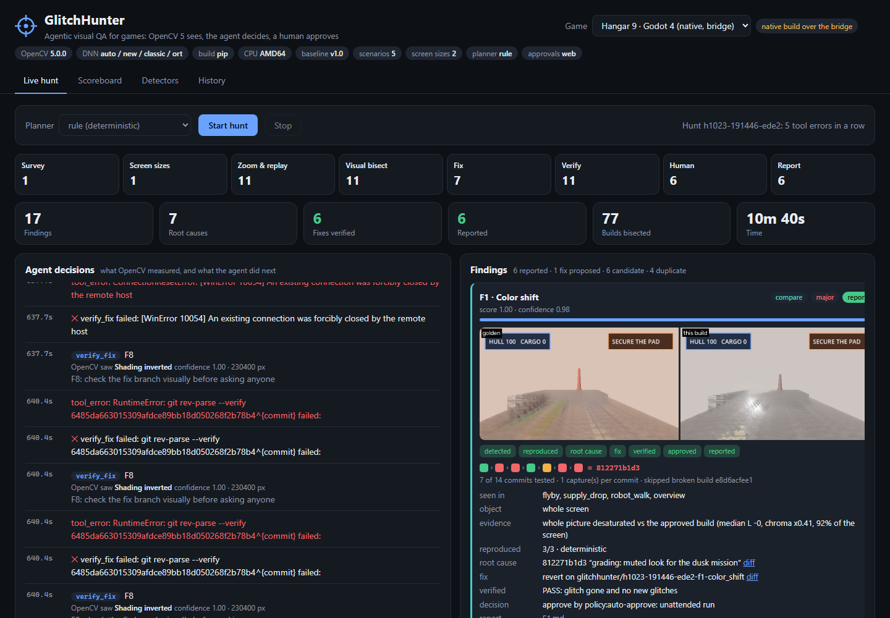
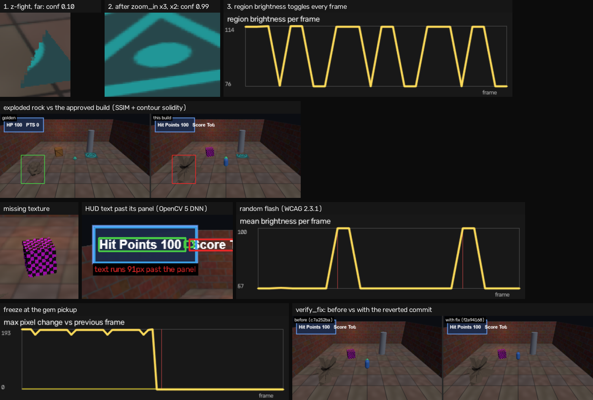

# GlitchHunter

**An agent that finds visual bugs in a game build by looking at it, bisects them to the commit that caused them, and proposes a verified fix. A human approves before anything is filed. Works with any engine.**

Built for the OpenCV AI Competition 2026 (Agentic Vision path). OpenCV 5 is the perception layer; the
agent's every next step (zoom in, check another screen size, replay, how many captures per commit,
search inside a merged branch, re-bisect, ask a human) is chosen from what OpenCV measured on the frames.

## What it does

1. **Sees.** Plays the scenarios of a game's test plan and reads the frames with **19 OpenCV 5
   detectors in five families**: classic (missing textures and Unity's error magenta, z-fighting,
   freezes, black screens, photosensitive flashes, exploded geometry, HUD text overflow with the
   OpenCV 5 DNN), motion (DIS optical flow: physics jitter, stutter, LOD and culling pops, characters
   sliding without animating), comparison with the approved build (colour/gamma shifts, shadow acne,
   blurry textures, objects that fell through the floor), lighting (inverted normal maps, missing
   shadows) and pixels (NaN blocks from shaders, UI cut off at other screen sizes).
2. **Investigates.** Small, uncertain evidence makes it **move the game camera closer** (active
   perception: ray-cast the region, re-aim, recapture). It checks the UI at other screen sizes, and
   replays to check reproducibility and determinism.
3. **Finds the cause.** **Visual git bisect**: a search over commits with the OpenCV detector as the
   test. Flaky glitches get more captures per commit, computed from the observed reproduction rate;
   commits that do not build are skipped; merged branches are searched inside; several commits are
   probed at once on parallel capture workers. Findings with the same culprit are one root cause.
4. **Fixes and checks.** Reverts the culprit on a branch, recaptures, and re-surveys every scenario
   and screen size to catch regressions (and to tell them apart from known bugs the fix unmasked).
5. **Asks.** Nothing is filed until a person approves on the dashboard; rejecting deletes the agent's
   branch. Every decision, with the evidence behind it, is in `trace.jsonl`.



The dashboard (`python -m glitchhunter serve`) shows the agent's pipeline stage by stage, every
decision next to what OpenCV measured, each finding's evidence, lifecycle, bisect path and culprit
diff, the approvals waiting for a person, the evaluation scoreboard and the detector catalog, and
switches between the test games.

## Any engine

| Engine | How | Status |
|---|---|---|
| Web (three.js, Babylon.js, PlayCanvas, any canvas) | headless Chromium + a drop-in test API module | tested on two three.js games and a minimal game built on the module alone |
| **Godot 4** | native build + bridge autoload, over TCP | tested end to end on Hangar 9 (Vulkan Forward+) |
| **Unity** | native build + bridge component + batch build script | type-checked against Unity's API; not run in a Unity project yet |
| Unreal, custom | the documented 9-command protocol + a reference engine | `bridge-check` grades an implementation |
| Anything, no integration | `scan-video` on a recording | detection, zoom, report (no bisect) |

```bash
python -m glitchhunter init --engine godot --dir path/to/game     # test plan + bridge
```

```bash
python -m glitchhunter bridge-check --repo path/to/game          # every command, and determinism
```

Details, the protocol and the same glitch in Unity, Unreal, Godot and three.js terms:
[docs/ENGINES.md](docs/ENGINES.md).

## Results

<!-- results:start -->
Three games, 28 planted bugs, 78 commits (with a merged branch and a commit that does not build).
Full numbers, ablations and clean-build checks: [eval/RESULTS.md](eval/RESULTS.md), written by
`python -m glitchhunter eval`.
<!-- results:end -->

| Game | Engine | Commits | Planted bugs |
|---|---|---|---|
| Crypt Runner | three.js | 17 | 7 (1 random) |
| Ironworks | three.js: skinned robot, shadows, bloom, custom post passes, physics substeps, LOD, instancing, follow camera | 33, with a merged branch | 10 (1 random) |
| Hangar 9 | **Godot 4.7**: ACES, glow, fog, spot shadows, CCD rigid bodies, AnimationPlayer, visibility-range LOD, normal maps, CPU particles, custom culling bounds, spatial shader, Control anchors | 28, with a merged branch and a broken build | 11 |

A complete hunt, with reports, evidence images and the decision trace, is in
[docs/sample-hunt](docs/sample-hunt/SUMMARY.md).



## How the vision output drives the next action

| OpenCV 5 observation | Agent's next tool call |
|---|---|
| Confidence < 0.6 on a small world-space region | `zoom_in`: ray-cast the region, move the camera closer, recapture |
| Still weak after zooming, or 0 of N replays on weak evidence | `dismiss` |
| 0 of N replays on strong evidence (confidence ≥ 0.8) | `replay` 8 more times first |
| The game supports other screen sizes | `sweep_viewports`: replay the UI scenarios at each size |
| Identical evidence on every replay | `bisect` with 1 capture per commit |
| Seen k of N replays, frames differ (flaky) | `bisect` with r = ceil(log 0.05 / log(1-p)) captures per commit |
| A commit does not build | skip it; report it if it could be the culprit |
| The first bad mainline commit is a merge | search inside the merged branch |
| Same culprit as another finding | one root cause: filed once |
| Glitch still visible on the fix build | `bisect` again with more captures, or `request_human` |
| New glitches on the fix build | verification fails, unless they are known bugs the fix unmasked, or HEAD shows them too (then they become new findings) |
| Verified fix | `request_human` -> `file_report` (approve) or delete branch (reject) |

Diagrams: [docs/ARCHITECTURE.md](docs/ARCHITECTURE.md). Technical report: [docs/REPORT.md](docs/REPORT.md).
For judges: [docs/JUDGING.md](docs/JUDGING.md) maps each rubric criterion to the evidence.

## Quick start (Windows, macOS, Linux)

Python 3.11+ and git. On Windows, clone to a short path such as `C:\dev\glitchhunter`: git object paths
in the work directory get long, and Windows refuses paths over 260 characters unless long paths are
enabled. If the repository path is long anyway, state goes to `%LOCALAPPDATA%\glitchhunter\work`
(override with `GH_WORK_DIR`).

```bash
python -m venv .venv
```

```bash
.venv/bin/pip install -r requirements.txt
```

(On Windows: `.venv\Scripts\pip install -r requirements.txt`, and use `.venv\Scripts\python` below.)

```bash
.venv/bin/python -m playwright install chromium
```

(On a fresh Linux machine use `install --with-deps chromium`, which also installs the system libraries.)

```bash
.venv/bin/python -m glitchhunter fetch-models
```

Build a test game's history (`crypt`, `ironworks`, or `hangar`, which needs Godot 4: put the binary on
PATH or set `GH_TOOL_GODOT`):

```bash
.venv/bin/python -m glitchhunter fixture --game ironworks
```

Then run a hunt in the terminal (unattended approval policy, recorded as such in the trace):

```bash
.venv/bin/python -m glitchhunter hunt --game ironworks --approval auto-approve
```

Or open the dashboard at http://127.0.0.1:8000 and approve findings yourself:

```bash
.venv/bin/python -m glitchhunter serve --game ironworks
```

Your own game: `--repo path/to/game` instead of `--game` (it needs a `glitchhunter.json`; `init` writes one).

### Other commands

| Command | What it does |
|---|---|
| `python -m glitchhunter init --engine <web/godot/unity/unreal/custom>` | Adds GlitchHunter to a game project: test plan + the engine's bridge |
| `python -m glitchhunter bridge-check --repo PATH` | Launches a native build and grades its bridge: every command, and determinism |
| `python -m glitchhunter scan-video playtest.mp4 [--golden approved.mp4]` | Finds glitches in a recording from any engine |
| `python -m glitchhunter record --game hangar --out run.mp4` | Records scenarios of a build to an MP4 |
| `python -m glitchhunter hunt --planner bedrock` | Claude on Amazon Bedrock plans the hunt (falls back to the rule planner on any Bedrock error) |
| `python -m glitchhunter deploy --repo-url <public git URL>` | Creates the AWS stack (Graviton, S3, Bedrock role, CloudWatch), waits, prints the dashboard link ([docs/SHIP.md](docs/SHIP.md)) |
| `python -m glitchhunter aws-doctor` | Checks AWS credentials, Bedrock access, S3 and CloudWatch step by step ([docs/AWS_SETUP.md](docs/AWS_SETUP.md)) |
| `python -m glitchhunter mcp` | MCP server (stdio) with 8 OpenCV tools for developer agents ([docs/MCP.md](docs/MCP.md)) |
| `python -m glitchhunter eval --game <game> --repeats 3` | Scores the agent against the planted bugs, with ablations; writes `eval/RESULTS*.md` |
| `python -m glitchhunter bench` | Times the OpenCV workload; compares pip OpenCV 5 with COOL on Graviton |
| `python -m glitchhunter info` | OpenCV build facts (version, DNN engines, CPU features) |
| `python -m pytest` | 110 tests; the 11 `slow` ones drive a real headless browser (`-m "not slow"` skips them) |

Add the MCP server to Claude Code:

```bash
claude mcp add glitchhunter -- python -m glitchhunter mcp
```

### Configuration

| Variable | Default | Meaning |
|---|---|---|
| `GH_GAME` / `GH_REPO` | `crypt` / unset | Built-in test game, or any game repo with a `glitchhunter.json` |
| `GH_PLANNER` | `rule` | `rule` or `bedrock` |
| `GH_BEDROCK_MODEL_ID` | `anthropic.claude-opus-5-5` | Bedrock model for the planner |
| `AWS_REGION` | `us-east-1` | Bedrock and S3 region |
| `GH_APPROVAL_MODE` | `auto-approve` (CLI), `web` (dashboard) | `web`, `cli`, `auto-approve`, `auto-reject` |
| `GH_WORKERS` | `2` | Parallel capture workers (browsers or game processes) |
| `GH_DETECT_THREADS` | up to `6` | Threads running OpenCV detectors in parallel (`1` = one after another) |
| `GH_TOOL_GODOT`, `GH_TOOL_UNITY` | lookup | Engine binaries for bridge launch/build commands |
| `GH_S3_BUCKET` | unset | Upload each hunt's artifacts to S3 |
| `GH_EMF` | unset | `stdout` to emit CloudWatch EMF metrics |
| `GH_API_TOKEN` | unset | Require `Authorization: Bearer` on every POST |
| `GH_WORK_DIR` | `<repo>/.work` | State: game repos, captures, hunts |
| `GH_DNN_ENGINE` | `auto` | OpenCV 5 DNN engine: `auto`, `new`, `classic` |

## Performance

Captures run on a pool of workers; bisect tests several commits per round (log_(k+1) n rounds);
detectors run in parallel threads (2-4x faster inspection); golden data is computed once per hunt;
and each image size and thread gets its own DIS optical-flow engine, which made flow-heavy detectors
twice as fast and their answers independent of what ran before (details in
[docs/ARCHITECTURE.md](docs/ARCHITECTURE.md#performance)).

## Continuous integration

[`.github/workflows/ci.yml`](.github/workflows/ci.yml) runs every test, a short hunt and the benchmark
on Linux x86_64 and Linux arm64 (`ubuntu-24.04-arm`, the same CPU family as AWS Graviton; free on
public repositories). It also builds and smoke-tests the Docker image on arm64.

## AWS deployment

[docs/AWS_SETUP.md](docs/AWS_SETUP.md) (credentials, Bedrock model access, `aws-doctor`) and
[deploy/README.md](deploy/README.md): a CloudFormation stack with a Graviton EC2 instance running the
container, an S3 bucket for artifacts, an IAM role for Claude on Amazon Bedrock, and CloudWatch logs
and metrics. It also covers the COOL benchmark procedure.

## Repository layout

| Path | Contents |
|---|---|
| `glitchhunter/vision/` | OpenCV 5 detectors: `classic`, `motion`, `compare`, `lighting`, `pixels`, shared `core` |
| `glitchhunter/textdnn.py` | OpenCV 5 DNN text detection + recognition (OpenCV Zoo models) |
| `glitchhunter/capture.py`, `bridge.py` | Web driver (headless Chromium) and native bridge driver |
| `glitchhunter/lab.py` | Driver pool, golden frames, inspection, git, fix branches |
| `glitchhunter/agent/` | Tools, rule planner, Bedrock planner, hunt loop, approvals, trace, reports |
| `glitchhunter/video.py` | Video triage for recordings from any engine |
| `glitchhunter/conformance.py`, `scaffold.py` | `bridge-check` and `init` |
| `glitchhunter/mcp_server.py`, `service.py` | MCP server and the shared low-level tools |
| `glitchhunter/api/` | FastAPI dashboard and HTTP API |
| `glitchhunter/games/`, `games/`, `fixture.py` | The three test games and their histories with planted bugs |
| `bridges/` | Godot autoload, Unity component + build script (+ type check), web module, Python reference engine |
| `glitchhunter/evaluate.py`, `bench.py` | Evaluation with ablations; OpenCV/COOL benchmark |
| `deploy/` | Dockerfile, CloudFormation, deployment guide |
| `docs/` | Report, architecture, engines, AWS setup, video script, sample hunt |

## Limitations

- The games and their bugs are ours; detectors were calibrated on them, which is also the evaluation
  set. Real games need their own scenarios in a `glitchhunter.json`.
- Unity and Unreal are not run end to end (no license here); Godot and web are.
- Web rendering is software WebGL (SwiftShader) for determinism; verified on x86_64, not yet on arm64.
- The Bedrock planner is implemented and tested with a scripted client; it was not run against live
  Bedrock during development (no AWS credentials were available). Likewise the Docker image and the
  CloudFormation stack have not been built or deployed yet (the template passes `cfn-lint`).
- See [docs/REPORT.md](docs/REPORT.md#8-limitations) for the full list.

## Credits

three.js (MIT, vendored in `games/vendor/three`). Godot Engine (MIT; downloaded separately, not
vendored). OpenCV Zoo PP-OCRv3 text detection and CRNN text recognition models (Apache-2.0),
downloaded by `fetch-models`.
