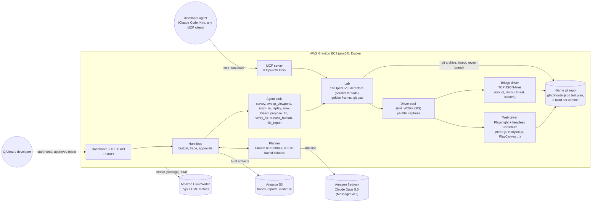
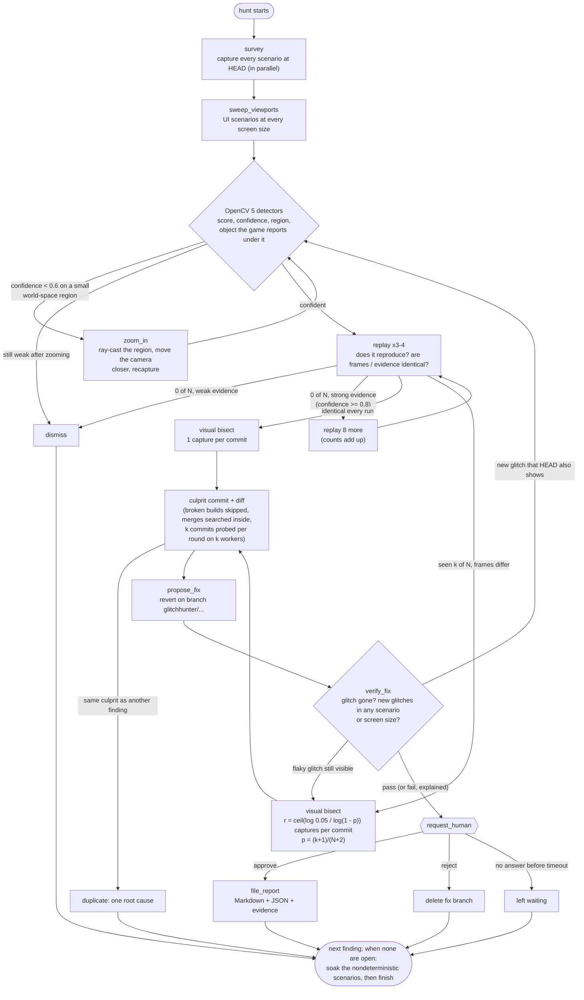

# Architecture

## System (OpenCV 5 + AWS + agent)

A recording from any engine takes a shorter path: `scan-video` reads it with OpenCV, splits it
into shots, runs the detectors that need no game hooks over sliding windows, zooms by re-reading
at native resolution, and asks a person before writing the report (no bisect: a recording has no
history).

## Agent workflow (perception -> decision -> action)

Every arrow out of a decision diamond is chosen from OpenCV 5 output.

## Capture: one interface, any engine

| | Web driver | Bridge driver |
|---|---|---|
| Build a commit | `git archive` into a cached folder | same, plus the project's `driver.build` command (Godot export, Unity batch build) |
| Start | headless Chromium (SwiftShader WebGL, deterministic), `?test=1&seed=&w=&h=` | the `driver.launch` command; the game connects back to a local port |
| Step | `window.__gh.advance(1)` | `{"cmd": "advance", "frames": 1}` |
| Frames | `canvas.toDataURL` | `{"cmd": "grab"}` (PNG) |
| Names | three.js `Raycaster` | engine ray cast (Godot physics, Unity `Physics.RaycastAll`) |
| Broken build | page error before the API appears | process exits, never connects, or logs a script error pattern |

Both return the same `Capture`; everything above the drivers (detectors, bisect, the planner, the
dashboard) is engine-agnostic. `bridge-check` grades a new bridge, determinism first.

## Where each decision comes from

| OpenCV 5 evidence | Measured with | Next action it triggers |
|---|---|---|
| Magenta/black checker, or flat error magenta (Unity) | HSV `inRange`, `morphologyEx`, `connectedComponentsWithStats`, checker balance and purity | Replay, then bisect with the region as the test |
| Small toggling region (z-fighting) | Temporal std and step maps, region-mean roughness; DIS flow says whether motion explains it | **Zoom in** while confidence < 0.6; dismiss if still weak |
| Frames identical while motion is expected | `norm(NORM_INF)` between consecutive frames (`NORM_L1` per pixel for lossy video) | Replay; bisect |
| >85% near-black frames, UI still drawn | Gray threshold fractions, bounding rect of what is still drawn | Bisect |
| Full-screen brightness spikes | Per-frame mean luma vs median/MAD (WCAG 2.3.1 count) | Replay x4; **repeats per commit chosen from the reproduction rate** |
| Spiky change versus the golden build | SSIM map, CIE Lab ΔE, contour solidity (`convexHull`), new edges (`Canny`, `HoughLinesP`); surface changes (relit, inverted, recoloured) are excluded | Replay, bisect, revert |
| UI text past its panel, or cut by the screen edge | OpenCV 5 DNN (`TextDetectionModel_DB`, PP-OCRv3 + CRNN), panel outlines from `Canny` rules | Sweep other screen sizes, bisect at the size that shows it |
| Whole picture changed tone | Lab lightness/chroma histograms on unchanged pixels, per-tile consistency, power-law gamma fit | Bisect (one finding for the whole screen) |
| New fine stripe pattern (shadow acne) | Contrast-normalized fine detail (`medianBlur` residual), structure-tensor coherence | Bisect |
| Blurry texture | Contrast-normalized Laplacian energy, SSIM to a blurred golden frame | Bisect |
| Object missing at the end | End-state Lab ΔE + SSIM, stands-out-from-surroundings test, average-colour shift (`GaussianBlur` at the object's scale), not a lighting change | Name it from the golden build (pick there), bisect |
| Relief lit the wrong way (inverted normal map) | Windowed NCC of contrast-normalized difference-of-Gaussians detail: coherent anti-correlation with the golden build | Bisect |
| Shadow missing | Brightness ratio vs golden after tone matching, same texture (NCC) and colour, a shadow edge golden has and this build lacks | Bisect |
| Object vibrates | DIS optical flow per pixel: lag-1 autocorrelation, direction flips, flow coherence | Replay, bisect |
| Uneven motion | DIS flow magnitude series vs its local median, periodic gaps | Bisect |
| Pop (LOD, culling, asset switch) | Flow-compensated residual (`remap` with DIS flow); under a moving camera a one-frame step in the difference to the golden run must confirm it | Bisect |
| Character slides without animating | DIS flow inside tracked blobs minus their rigid motion (articulation) vs golden | Name it from the pixels on the figure, bisect (into merged branches) |
| NaN blocks | Dead-black components inside lit surroundings, lit in golden | Bisect |
| Identical frames on every replay | Frame hashes across replays | 1 capture per commit instead of r |
| Glitch still visible on the fix build | Same detector on the fix commit | Re-bisect with more repeats, or ask a human |
| New detections on the fix build | Survey of every scenario and screen size on the fix commit | Fail verification, unless it is an already-known glitch the fix unmasked, or HEAD shows it too on recheck (then it becomes a new finding) |
| Strong evidence that does not reproduce | Replay counts | 8 more replays before dismissing |

## Performance

| Where | What | Effect |
|---|---|---|
| Captures | A pool of drivers (`GH_WORKERS`, default 2), each with its own browser or game process; survey, replay, verification and bisect probes run on all of them | Survey and verification in about half the time |
| Bisect | With k workers, each round tests k evenly spaced commits at once (`git bisect skip` semantics for broken builds) | log_(k+1)(n) rounds instead of log_2(n) |
| Detectors | Run in parallel threads (`GH_DETECT_THREADS`, default up to 6); OpenCV releases the GIL | 2-4x faster inspection on a 12-thread CPU |
| Optical flow | One DIS engine per image size and thread: DIS adapts its patch size to the first small crop it sees and keeps it, so a shared engine answered differently (and slower) depending on what ran before | Same answer every time; flow-heavy detectors 2x faster |
| Golden frames and their derived data (pop events, tracks, residuals) | Cached per scenario, camera and screen size | Computed once per hunt |
