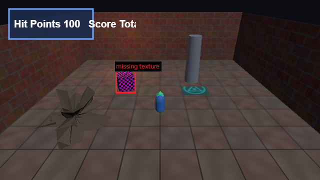
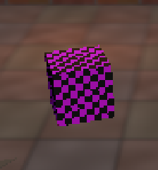
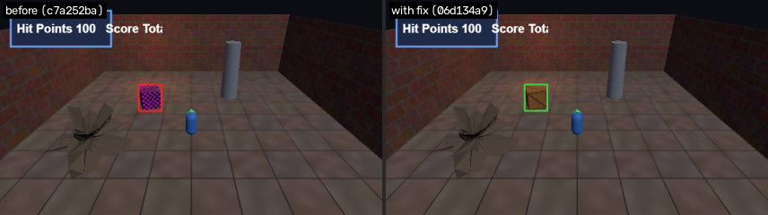

# F1: Missing texture placeholder on crate

- **Severity:** major
- **Detector:** `missing_texture`: Magenta/black checker placeholder where a texture failed to load.
- **Seen in:** walk_to_gem, overview
- **Build:** `c7a252ba80` (hunt `h1023-030846-08f5`)
- **Evidence:** 668 px of magenta/black checker (engine missing-texture placeholder)

## Steps to reproduce

1. Build the game at the commit above and open `index.html?test=1&seed=1`.
2. Scenario `walk_to_gem`: Player holds W and walks forward through the gem pickup; 60 frames.

Reproduced **3/3** replays; frames were identical every run (deterministic).

## Visual evidence

**annotated**



**closeup**



**before after fix**



## Culprit (visual git bisect)

Searched 9 commits between `ad32e651f1` (good) and `c7a252ba80` (bad) with 1 capture(s) per commit; 5 builds tested.

| commit | subject | verdict | captures |
|---|---|---|---|
| `ad32e651f1` | add map view on the M key | good | 1 |
| `c7a252ba80` | add credits header | bad | 1 |
| `c64d8467d7` | add ambient lightning flashes | bad | 1 |
| `c08ccda574` | reorganize texture paths | bad | 1 |
| `cc5f7ba284` | tweak torch color | good | 1 |

**First bad commit:** `c08ccda574` reorganize texture paths

```diff
diff --git a/game.js b/game.js
index 2081c41..648d655 100644
--- a/game.js
+++ b/game.js
@@ -1,3 +1,4 @@
 // Crypt Runner: a tiny three.js dungeon scene.
+// Credits: textures are generated procedurally by the build script.
 import * as THREE from './vendor/three.module.js';
```

## Proposed fix

Branch `glitchhunter/h1023-030846-08f5-f1-missing_texture` at `06d134a9de` (revert).

```diff
Revert "reorganize texture paths"

diff --git a/game.js b/game.js
index 648d655..9415ee4 100644
--- a/game.js
+++ b/game.js
@@ -38,5 +38,5 @@ const TEX = {
   floor: 'assets/floor_tiles.png',
   wall: 'assets/wall_bricks.png',
-  crate: 'assets/props/crate_wood.png',
+  crate: 'assets/crate_wood.png',
   rune: 'assets/rune.png',
 };
```

## Verification

**PASS**: glitch gone and no new glitches (1 targeted capture(s) on the fix build plus a survey of every scenario).

## Human decision

Question: F1 (missing_texture on crate): culprit c08ccda574 'reorganize texture paths'. The revert removes the glitch with no new glitches. File the bug and keep the fix branch?

Decision: **approve** by `web`, note: approved by test script

## Status history

- None -> **candidate**: 763 px of magenta/black checker (engine missing-texture placeholder)
- candidate -> **confirmed**: reproduced 3/3
- confirmed -> **bisected**: first bad commit c08ccda574 'reorganize texture paths'
- bisected -> **fix_proposed**: revert of c08ccda574 on branch glitchhunter/h1023-030846-08f5-f1-missing_texture
- fix_proposed -> **fix_verified**: glitch gone and no new glitches
- fix_verified -> **awaiting_approval**: waiting for a human decision
- awaiting_approval -> **approved**: approved by web
