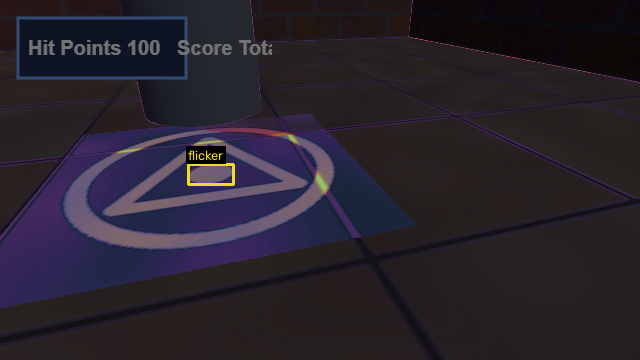
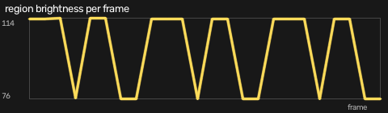
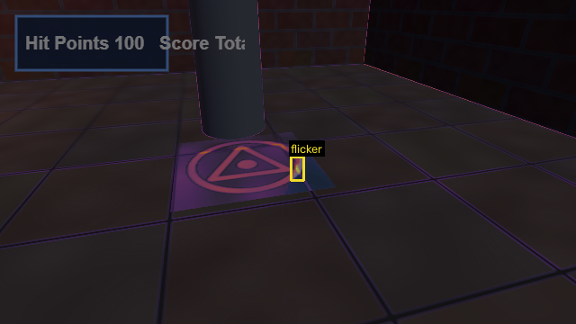
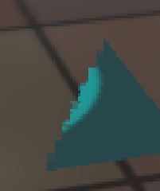
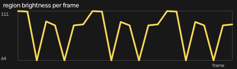
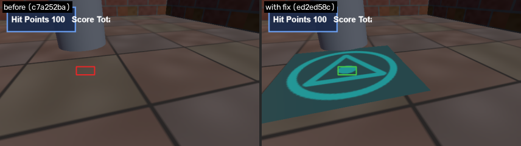

# F2: Z-fighting flicker on floor+rune_decal

- **Severity:** minor
- **Detector:** `zfight_flicker`: Surfaces toggling between frames under a static camera (z-fighting).
- **Seen in:** overview
- **Build:** `c7a252ba80` (hunt `h1023-030846-08f5`)
- **Evidence:** 662 px region toggles 11x in 24 frames (z-fighting / flicker)
- **Coplanar surfaces at the hit point:** floor, rune_decal

## Steps to reproduce

1. Build the game at the commit above and open `index.html?test=1&seed=1`.
2. Scenario `overview`: Static default camera over the whole room for 24 frames.
3. Camera: position [3.3097, 1.25, 1.2903], looking at [4.0059, 0.0, -0.9478] (the agent zoomed in 2x).

Reproduced **3/3** replays; frames were identical every run (deterministic).

## Visual evidence

**heatmap**



**closeup**


**series**



**before heatmap**



**before closeup**



**before series**



**before after fix**



## Culprit (visual git bisect)

Searched 9 commits between `ad32e651f1` (good) and `c7a252ba80` (bad) with 1 capture(s) per commit; 5 builds tested.

| commit | subject | verdict | captures |
|---|---|---|---|
| `ad32e651f1` | add map view on the M key | good | 1 |
| `c7a252ba80` | add credits header | bad | 1 |
| `c64d8467d7` | add ambient lightning flashes | bad | 1 |
| `c08ccda574` | reorganize texture paths | good | 1 |
| `ba98e5d336` | snap rune decal flush to the floor | bad | 1 |

**First bad commit:** `ba98e5d336` snap rune decal flush to the floor

```diff
diff --git a/game.js b/game.js
index 2081c41..648d655 100644
--- a/game.js
+++ b/game.js
@@ -1,3 +1,4 @@
 // Crypt Runner: a tiny three.js dungeon scene.
+// Credits: textures are generated procedurally by the build script.
 import * as THREE from './vendor/three.module.js';
```

## Proposed fix

Branch `glitchhunter/h1023-030846-08f5-f2-zfight_flicker` at `ed2ed58c7f` (revert).

```diff
Revert "snap rune decal flush to the floor"

diff --git a/game.js b/game.js
index 648d655..15e5e8a 100644
--- a/game.js
+++ b/game.js
@@ -146,5 +146,5 @@ loadTex(TEX.rune, runeMat);
 const rune = new THREE.Mesh(new THREE.PlaneGeometry(2.4, 2.4), runeMat);
 rune.rotation.x = -Math.PI / 2;
-rune.position.set(3.2, 0.0, -1.4); // sit flush on the floor
+rune.position.set(3.2, 0.02, -1.4);
 rune.name = 'rune_decal';
 scene.add(rune);
```

## Verification

**PASS**: glitch gone and no new glitches (1 targeted capture(s) on the fix build plus a survey of every scenario).

## Human decision

Question: F2 (zfight_flicker on floor+rune_decal): culprit ba98e5d336 'snap rune decal flush to the floor'. The revert removes the glitch with no new glitches. File the bug and keep the fix branch?

Decision: **approve** by `web`, note: approved by test script

## Status history

- None -> **candidate**: 52 px region toggles 9x in 20 frames (z-fighting / flicker)
- candidate -> **confirmed**: reproduced 3/3
- confirmed -> **bisected**: first bad commit ba98e5d336 'snap rune decal flush to the floor'
- bisected -> **fix_proposed**: revert of ba98e5d336 on branch glitchhunter/h1023-030846-08f5-f2-zfight_flicker
- fix_proposed -> **fix_verified**: glitch gone and no new glitches
- fix_verified -> **awaiting_approval**: waiting for a human decision
- awaiting_approval -> **approved**: approved by web
