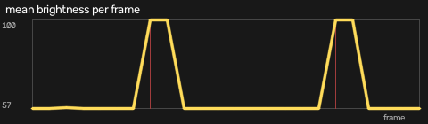
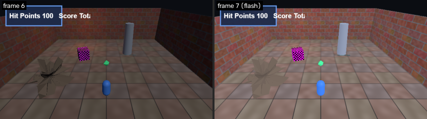
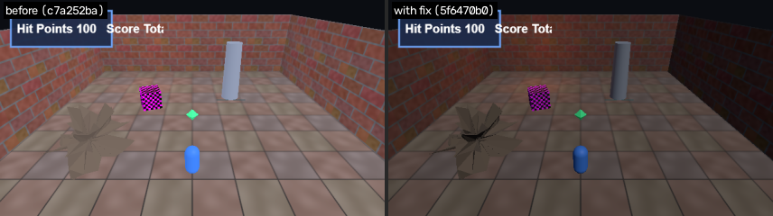

# F3: Full-screen flashes (photosensitivity risk)

- **Severity:** major
- **Detector:** `flash`: Full-screen brightness spikes (photosensitivity / WCAG 2.3.1).
- **Seen in:** overview
- **Build:** `c7a252ba80` (hunt `h1023-030846-08f5`)
- **Evidence:** 2 full-screen flash(es), brightness +42 over the median (photosensitivity risk)

## Steps to reproduce

1. Build the game at the commit above and open `index.html?test=1&seed=1`.
2. Scenario `overview`: Static default camera over the whole room for 24 frames.

Reproduced **1/4** replays; frames were different between runs (flaky).

## Visual evidence

**luma plot**



**flash frame**



**before after fix**



## Culprit (visual git bisect)

Searched 9 commits between `ad32e651f1` (good) and `c7a252ba80` (bad) with 8 capture(s) per commit; 5 builds tested.

| commit | subject | verdict | captures |
|---|---|---|---|
| `ad32e651f1` | add map view on the M key | good | 8 |
| `c7a252ba80` | add credits header | bad | 2 |
| `c64d8467d7` | add ambient lightning flashes | bad | 1 |
| `c08ccda574` | reorganize texture paths | good | 8 |
| `ba98e5d336` | snap rune decal flush to the floor | good | 8 |

**First bad commit:** `c64d8467d7` add ambient lightning flashes

```diff
diff --git a/game.js b/game.js
index 2081c41..648d655 100644
--- a/game.js
+++ b/game.js
@@ -1,3 +1,4 @@
 // Crypt Runner: a tiny three.js dungeon scene.
+// Credits: textures are generated procedurally by the build script.
 import * as THREE from './vendor/three.module.js';
```

## Proposed fix

Branch `glitchhunter/h1023-030846-08f5-f3-flash` at `5f6470b079` (revert).

```diff
Revert "add ambient lightning flashes"

diff --git a/game.js b/game.js
index 648d655..fadc444 100644
--- a/game.js
+++ b/game.js
@@ -278,15 +278,4 @@ function toggleMap() {
 }
 
-// --- ambient lightning ----------------------------------------------------------
-const flashLight = new THREE.AmbientLight(0xdfe8ff, 0);
-scene.add(flashLight);
-let flash = 0;
-
-function updateLightning() {
-  if (flash > 0) flash -= 1;
-  else if (Math.random() < 0.02) flash = 2;
-  flashLight.intensity = flash > 0 ? 3.5 : 0;
-}
-
 // --- loop -----------------------------------------------------------------------
 let frame = 0;
@@ -325,5 +314,4 @@ function tick() {
     torch.intensity = 18 * (0.92 + 0.08 * Math.sin(frame * 0.37) * Math.sin(frame * 0.11 + 1.3));
     updatePlayer();
-    updateLightning();
     renderFrame();
   } catch (e) {
```

## Verification

**PASS**: glitch gone and no new glitches (8 targeted capture(s) on the fix build plus a survey of every scenario).

## Human decision

Question: F3 (flash on overview): culprit c64d8467d7 'add ambient lightning flashes'. The revert removes the glitch with no new glitches. File the bug and keep the fix branch?

Decision: **approve** by `web`, note: approved by test script

## Status history

- None -> **candidate**: 2 full-screen flash(es), brightness +42 over the median (photosensitivity risk)
- candidate -> **flaky**: reproduced 1/4; frames differ run to run
- flaky -> **bisected**: first bad commit c64d8467d7 'add ambient lightning flashes'
- bisected -> **fix_proposed**: revert of c64d8467d7 on branch glitchhunter/h1023-030846-08f5-f3-flash
- fix_proposed -> **fix_verified**: glitch gone and no new glitches
- fix_verified -> **awaiting_approval**: waiting for a human decision
- awaiting_approval -> **approved**: approved by web
