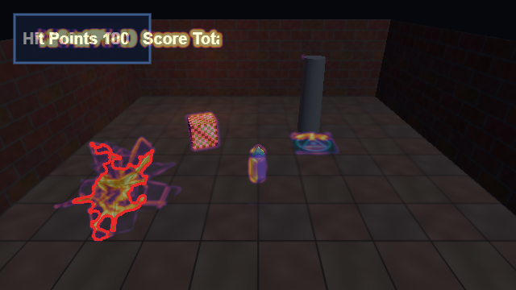
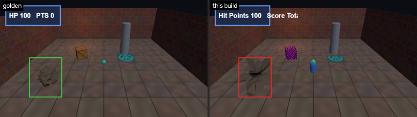
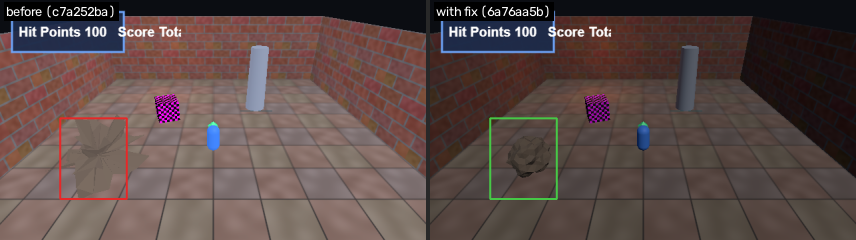

# F4: Exploded / stretched geometry on rock

- **Severity:** major
- **Detector:** `geometry_explosion`: Large spiky shapes that differ from the golden frame (exploded or stretched mesh).
- **Seen in:** walk_to_gem, overview
- **Build:** `c7a252ba80` (hunt `h1023-030846-08f5`)
- **Evidence:** 3990 px spiky region (solidity 0.49) differs from the golden frame

## Steps to reproduce

1. Build the game at the commit above and open `index.html?test=1&seed=1`.
2. Scenario `walk_to_gem`: Player holds W and walks forward through the gem pickup; 60 frames.

Reproduced **3/3** replays; frames were different between runs (flaky).

## Visual evidence

**diff**



**golden vs now**



**before after fix**



## Culprit (visual git bisect)

Searched 9 commits between `ad32e651f1` (good) and `c7a252ba80` (bad) with 2 capture(s) per commit; 5 builds tested.

| commit | subject | verdict | captures |
|---|---|---|---|
| `ad32e651f1` | add map view on the M key | good | 2 |
| `c7a252ba80` | add credits header | bad | 1 |
| `c64d8467d7` | add ambient lightning flashes | good | 2 |
| `ae5601f66e` | use per-gem reward values on pickup | bad | 1 |
| `1f366b94a3` | tune rock noise amplitude | bad | 1 |

**First bad commit:** `1f366b94a3` tune rock noise amplitude

```diff
diff --git a/game.js b/game.js
index 2081c41..648d655 100644
--- a/game.js
+++ b/game.js
@@ -1,3 +1,4 @@
 // Crypt Runner: a tiny three.js dungeon scene.
+// Credits: textures are generated procedurally by the build script.
 import * as THREE from './vendor/three.module.js';
```

## Proposed fix

Branch `glitchhunter/h1023-030846-08f5-f4-geometry_explosion` at `6a76aa5b5e` (revert).

```diff
Revert "tune rock noise amplitude"

diff --git a/game.js b/game.js
index 648d655..793c39c 100644
--- a/game.js
+++ b/game.js
@@ -172,5 +172,5 @@ function displaceRock(geometry, amp) {
 }
 
-const ROCK_NOISE_AMP = 1.8; // bolder silhouette
+const ROCK_NOISE_AMP = 0.18;
 const rockGeo = new THREE.IcosahedronGeometry(0.9, 3);
 displaceRock(rockGeo, ROCK_NOISE_AMP);
```

## Verification

**PASS**: glitch gone and no new glitches; it unmasks already-known glitches ['flash'] (2 targeted capture(s) on the fix build plus a survey of every scenario).

## Human decision

Question: F4 (geometry_explosion on rock): culprit 1f366b94a3 'tune rock noise amplitude'. The revert removes the glitch with no new glitches. File the bug and keep the fix branch?

Decision: **approve** by `web`, note: approved by test script

## Status history

- None -> **candidate**: 3681 px spiky region (solidity 0.48) differs from the golden frame
- candidate -> **confirmed**: reproduced 3/3 (frames differ run to run)
- confirmed -> **bisected**: first bad commit 1f366b94a3 'tune rock noise amplitude'
- bisected -> **fix_proposed**: revert of 1f366b94a3 on branch glitchhunter/h1023-030846-08f5-f4-geometry_explosion
- fix_proposed -> **fix_verified**: glitch gone and no new glitches; it unmasks already-known glitches ['flash']
- fix_verified -> **awaiting_approval**: waiting for a human decision
- awaiting_approval -> **approved**: approved by web
