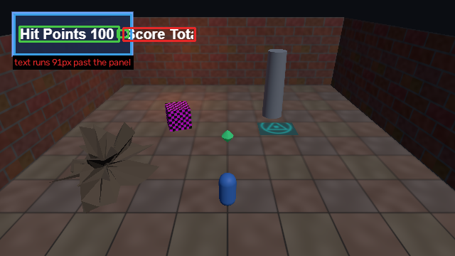
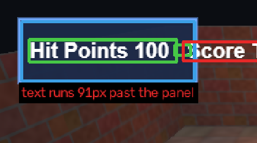
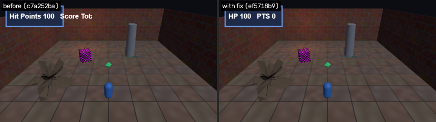

# F5: HUD text overflows its panel

- **Severity:** minor
- **Detector:** `hud_text_overflow`: UI text running past its panel (OpenCV DNN text detection).
- **Seen in:** overview, walk_to_gem, map_view
- **Build:** `c7a252ba80` (hunt `h1023-030846-08f5`)
- **Evidence:** UI text ['scoreltot'] extends 91px beyond its panel

## Steps to reproduce

1. Build the game at the commit above and open `index.html?test=1&seed=1`.
2. Scenario `overview`: Static default camera over the whole room for 24 frames.

Reproduced **3/3** replays; frames were identical every run (deterministic).

## Visual evidence

**annotated**



**closeup**



**before after fix**



## Culprit (visual git bisect)

Searched 9 commits between `ad32e651f1` (good) and `c7a252ba80` (bad) with 1 capture(s) per commit; 5 builds tested.

| commit | subject | verdict | captures |
|---|---|---|---|
| `ad32e651f1` | add map view on the M key | good | 1 |
| `c7a252ba80` | add credits header | bad | 1 |
| `c64d8467d7` | add ambient lightning flashes | good | 1 |
| `ae5601f66e` | use per-gem reward values on pickup | good | 1 |
| `b1d02d0348` | localize HUD labels | bad | 1 |

**First bad commit:** `b1d02d0348` localize HUD labels

```diff
diff --git a/game.js b/game.js
index 2081c41..648d655 100644
--- a/game.js
+++ b/game.js
@@ -1,3 +1,4 @@
 // Crypt Runner: a tiny three.js dungeon scene.
+// Credits: textures are generated procedurally by the build script.
 import * as THREE from './vendor/three.module.js';
```

## Proposed fix

Branch `glitchhunter/h1023-030846-08f5-f5-hud_text_overflow` at `ef5718b92c` (revert).

```diff
Revert "localize HUD labels"

diff --git a/game.js b/game.js
index 648d655..8daa763 100644
--- a/game.js
+++ b/game.js
@@ -234,5 +234,5 @@ const hudQuad = new THREE.Mesh(
 hudQuad.position.set(16 + 128, H - 16 - 32, 0);
 hudScene.add(hudQuad);
-const LABELS = { hp: 'Hit Points', score: 'Score Total' };
+const LABELS = { hp: 'HP', score: 'PTS' };
 
 const hud = {
```

## Verification

**PASS**: glitch gone and no new glitches (1 targeted capture(s) on the fix build plus a survey of every scenario).

## Human decision

Question: F5 (hud_text_overflow on overview): culprit b1d02d0348 'localize HUD labels'. The revert removes the glitch with no new glitches. File the bug and keep the fix branch?

Decision: **approve** by `web`, note: approved by test script

## Status history

- None -> **candidate**: UI text ['scoreltot'] extends 91px beyond its panel
- candidate -> **confirmed**: reproduced 3/3
- confirmed -> **bisected**: first bad commit b1d02d0348 'localize HUD labels'
- bisected -> **fix_proposed**: revert of b1d02d0348 on branch glitchhunter/h1023-030846-08f5-f5-hud_text_overflow
- fix_proposed -> **fix_verified**: glitch gone and no new glitches
- fix_verified -> **awaiting_approval**: waiting for a human decision
- awaiting_approval -> **approved**: approved by web
