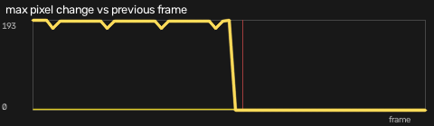
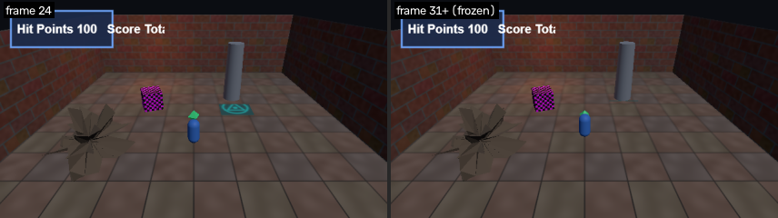
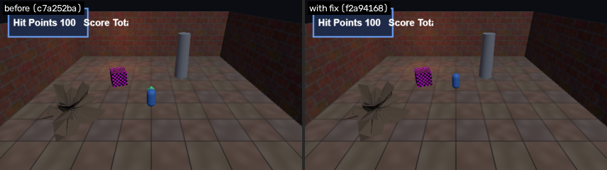

# F6: Game freezes during 'walk_to_gem'

- **Severity:** critical
- **Detector:** `frozen_frame`: Picture stops changing while the scenario expects motion (hang / dead game loop).
- **Seen in:** walk_to_gem
- **Build:** `c7a252ba80` (hunt `h1023-030846-08f5`)
- **Evidence:** picture stops changing at frame 31 (t=1.03s) and stays frozen for 29 frames until the end

## Steps to reproduce

1. Build the game at the commit above and open `index.html?test=1&seed=1`.
2. Scenario `walk_to_gem`: Player holds W and walks forward through the gem pickup; 60 frames.

Reproduced **3/3** replays; frames were identical every run (deterministic).

## Visual evidence

**diff plot**



**before after**



**before after fix**



## Culprit (visual git bisect)

Searched 9 commits between `ad32e651f1` (good) and `c7a252ba80` (bad) with 1 capture(s) per commit; 5 builds tested.

| commit | subject | verdict | captures |
|---|---|---|---|
| `ad32e651f1` | add map view on the M key | good | 1 |
| `c7a252ba80` | add credits header | bad | 1 |
| `c64d8467d7` | add ambient lightning flashes | good | 1 |
| `ae5601f66e` | use per-gem reward values on pickup | bad | 1 |
| `1f366b94a3` | tune rock noise amplitude | good | 1 |

**First bad commit:** `ae5601f66e` use per-gem reward values on pickup

```diff
diff --git a/game.js b/game.js
index 2081c41..648d655 100644
--- a/game.js
+++ b/game.js
@@ -1,3 +1,4 @@
 // Crypt Runner: a tiny three.js dungeon scene.
+// Credits: textures are generated procedurally by the build script.
 import * as THREE from './vendor/three.module.js';
```

## Proposed fix

Branch `glitchhunter/h1023-030846-08f5-f6-frozen_frame` at `f2a94168ea` (revert).

```diff
Revert "use per-gem reward values on pickup"

diff --git a/game.js b/game.js
index 648d655..cf5ffd7 100644
--- a/game.js
+++ b/game.js
@@ -212,5 +212,5 @@ function updatePlayer() {
   if (gem.visible && player.position.distanceTo(gem.position) < 0.9) {
     gem.visible = false;
-    score += gem.userData.reward.points;
+    score += 10;
     hud.draw();
   }
```

## Verification

**PASS**: glitch gone and no new glitches; it unmasks already-known glitches ['flash', 'zfight_flicker'] (1 targeted capture(s) on the fix build plus a survey of every scenario).

## Human decision

Question: F6 (frozen_frame on walk_to_gem): culprit ae5601f66e 'use per-gem reward values on pickup'. The revert removes the glitch with no new glitches. File the bug and keep the fix branch?

Decision: **approve** by `web`, note: Confirmed in the dashboard test: freeze happens right at the gem pickup.

## Status history

- None -> **candidate**: picture stops changing at frame 31 (t=1.03s) and stays frozen for 29 frames until the end
- candidate -> **confirmed**: reproduced 3/3
- confirmed -> **bisected**: first bad commit ae5601f66e 'use per-gem reward values on pickup'
- bisected -> **fix_proposed**: revert of ae5601f66e on branch glitchhunter/h1023-030846-08f5-f6-frozen_frame
- fix_proposed -> **fix_verified**: glitch gone and no new glitches; it unmasks already-known glitches ['flash', 'zfight_flicker']
- fix_verified -> **awaiting_approval**: waiting for a human decision
- awaiting_approval -> **approved**: approved by web
